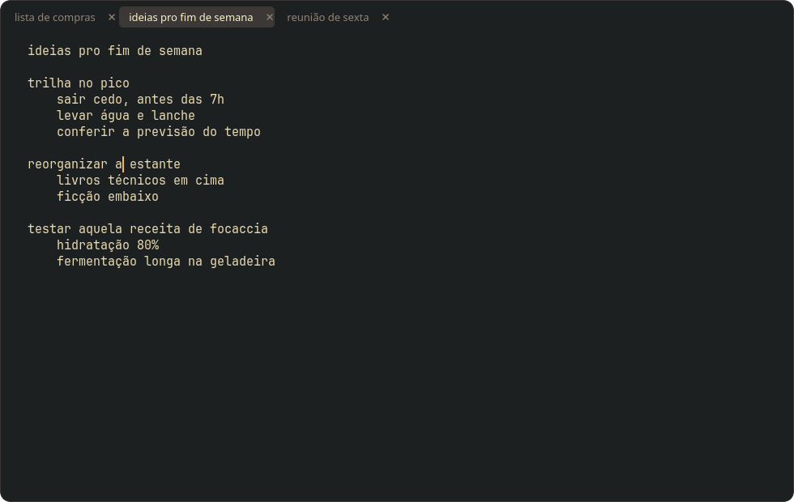
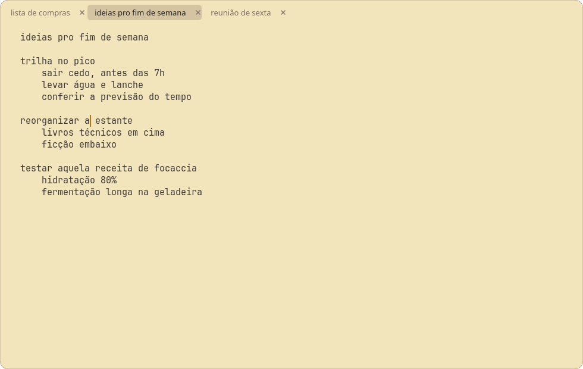
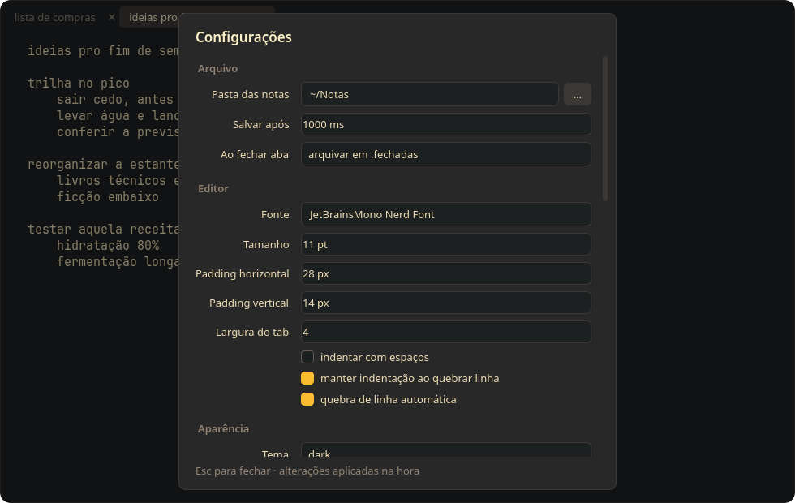

# notas

Bloco de notas minimalista para Linux, em **Qt 6 / C++**. Funciona como o Bloco de Notas do Windows, só texto puro e sem markdown, com abas que nunca se perdem, salvamento automático e os atalhos de edição do VSCode, incluindo multi-cursor.

Não tem menus nem barras: a interface é só o texto. As configurações abrem com `Ctrl+,` e também ficam num arquivo JSON.



| Tema claro | Configurações (`Ctrl+,`) |
|---|---|
|  |  |

## Recursos

- **Abas persistentes**: cada aba é um `.txt` na pasta das notas e continua lá entre execuções até você fechar com `Ctrl+W` ou no `×`. `Ctrl+Shift+T` reabre a última aba fechada.
- **Salvamento automático** depois de um tempo sem digitar (1 s por padrão). Sem diálogos de "salvar como".
- **Multi-cursor estilo VSCode**: `Alt+Shift+↑/↓`, `Alt+Clique`, `Ctrl+D`, `Ctrl+Shift+L`.
- **Edição por linha**: mover, duplicar, apagar e selecionar linhas, Tab e Shift+Tab indentam, Home inteligente, auto-indentação.
- **Temas em JSON** (Gruvbox claro e escuro inclusos). No modo `auto` o tema segue o claro/escuro do sistema.
- **Configuração em texto** (`~/.config/notas/config.json`), recarregada ao vivo.
- **Linha de comando no estilo GNU**: entrada padrão, listar e imprimir notas, instância única.
- Padding do texto, fonte, quebra de linha e cantos arredondados configuráveis.
- Notas são arquivos comuns: dá para usar `grep`, `git`, Syncthing e o que mais quiser.

## Instalação

Dependências: `qt6-base`, `gcc` e `make`. No Arch:

```sh
sudo pacman -S --needed qt6-base base-devel
```

Compilar e instalar em `~/.local`:

```sh
git clone https://github.com/eduardo-moro/notas.git
cd notas
qmake6 PREFIX=$HOME/.local -o build/Makefile notas.pro
make -C build -j$(nproc)
make -C build install
```

Isso instala o binário, o atalho `.desktop`, a man page (`man notas`) e o completion do fish. Para instalar no sistema todo, use `PREFIX=/usr/local` e `sudo make -C build install`.

## Uso

```sh
notas                         # abre a janela (ou traz para frente a que já está aberta)
notas lista.txt               # abre um arquivo qualquer numa aba
echo "ligar pro banco" | notas -
notas -t "comprar café"       # cria uma nota com esse texto
notas -l                      # lista as notas: índice, id e título (separados por TAB)
notas -p 2                    # imprime a nota 2 na saída padrão
notas --settings              # abre as configurações
grep -ri ideia "$(notas --path)"
```

Só existe uma janela por usuário: chamar `notas` com o app já aberto repassa os argumentos para a janela existente. `SIGTERM`, `SIGINT` e `SIGHUP` salvam tudo antes de sair.

## Atalhos

| Atalho | Ação |
|---|---|
| `Ctrl+T` / `Ctrl+N` | nova aba |
| `Ctrl+W` | fechar aba |
| `Ctrl+Shift+T` | reabrir aba fechada |
| `Ctrl+Tab` / `Ctrl+Shift+Tab` | próxima / anterior aba |
| `Ctrl+PgDn` / `Ctrl+PgUp` | próxima / anterior aba |
| `Ctrl+Shift+PgDn/PgUp` | mover aba |
| `Alt+1` … `Alt+9` | ir para a aba (9 = última) |
| `Alt+Shift+↑/↓` | adicionar cursor acima / abaixo |
| `Alt+Clique` | adicionar / remover cursor |
| `Esc` | remover cursores extras |
| `Ctrl+D` | selecionar a próxima ocorrência |
| `Ctrl+Shift+L` | selecionar todas as ocorrências |
| `Alt+↑/↓` | mover linha |
| `Ctrl+Shift+Alt+↑/↓` | duplicar linha |
| `Ctrl+Shift+K` | apagar linha |
| `Ctrl+L` | selecionar linha |
| `Ctrl+Enter` / `Ctrl+Shift+Enter` | nova linha abaixo / acima |
| `Tab` / `Shift+Tab` | indentar / desindentar |
| `Ctrl+]` / `Ctrl+[` | indentar / desindentar a linha |
| `Ctrl+C` / `Ctrl+X` sem seleção | copiar / cortar a linha inteira |
| `Ctrl+F` | buscar (`Enter` próximo, `Shift+Enter` anterior, `Alt+Enter` vira multi-cursor) |
| `F3` / `Shift+F3` | próxima / anterior ocorrência |
| `Ctrl+=` / `Ctrl+-` / `Ctrl+0` | zoom (também `Ctrl+roda`) |
| `Ctrl+S` | salvar agora |
| `Ctrl+,` | configurações |
| `Ctrl+Shift+,` | abrir o `config.json` numa aba |
| `Ctrl+Q` | sair |

Arrastar o espaço vazio ao lado das abas move a janela, e um duplo clique ali abre uma aba nova. Clicar com o botão do meio numa aba fecha a aba.

## Configuração

`$XDG_CONFIG_HOME/notas/config.json` (normalmente `~/.config/notas/config.json`):

```json
{
    "notesDir": "~/Notas",
    "autosaveMs": 1000,
    "font": { "family": "monospace", "size": 11 },
    "padding": { "horizontal": 28, "vertical": 14 },
    "indent": { "width": 4, "spaces": false, "auto": true },
    "wordWrap": true,
    "theme": { "mode": "auto", "dark": "gruvbox-dark", "light": "gruvbox-light" },
    "radius": { "window": 12, "elements": 8 },
    "onClose": "archive"
}
```

- O app recarrega o arquivo assim que ele muda no disco. Se houver erro de sintaxe, o aviso vai para o stderr e a última configuração válida continua valendo.
- `theme.mode`: `auto`, `dark`, `light`, o nome de um tema ou o caminho de um `.json`. No `auto`, o app lê `~/.config/hypr/.current-theme` (`dark`/`light`) e troca sozinho quando esse arquivo muda.
- `radius.window`: cantos da janela. Use `0` se o compositor já arredonda as janelas.
- `onClose`: `archive` move a nota fechada para `.fechadas/` (pode ser reaberta), e `delete` apaga o arquivo.

## Temas

Os temas ficam em `~/.config/notas/themes/*.json`. Na primeira execução são criados `gruvbox-dark.json` e `gruvbox-light.json`:

```json
{
    "name": "gruvbox-dark",
    "dark": true,
    "colors": {
        "base": "#1d2021", "card": "#282828",
        "surface": "#3c3836", "surface2": "#504945", "surface3": "#665c54",
        "text": "#ebdbb2", "textStrong": "#fbf1c7", "muted": "#928374",
        "accent": "#fabd2f", "cursor": "#fabd2f",
        "selection": "#504945", "search": "#fabd2f46"
    },
    "css": ""
}
```

As cores aceitam `#RGB`, `#RRGGBB` e `#RRGGBBAA`. Uma cor que você não definir vem do tema embutido. O campo `css` é anexado à folha de estilo Qt, para ajustes finos. Se existir um `~/gruvbox_theme.css` no formato de paleta, os temas iniciais são gerados a partir dele.

## Arquivos

| Caminho | Conteúdo |
|---|---|
| `~/.config/notas/config.json` | configuração |
| `~/.config/notas/themes/` | temas |
| `<notesDir>/*.txt` | as notas (UTF-8) |
| `<notesDir>/.session.json` | ordem das abas, aba atual, cursores |
| `<notesDir>/.fechadas/` | notas fechadas |

Qualquer `.txt` colocado na pasta das notas vira uma aba.

## Licença

[MIT](LICENSE)
